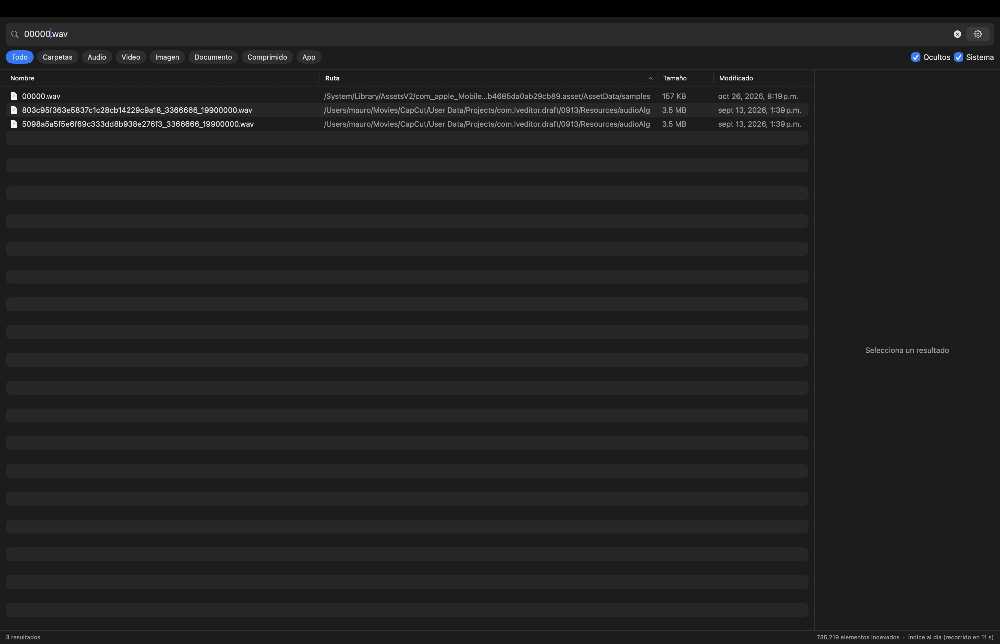

# Buscador M40

**Español** · [English](#english)

Buscador de archivos para macOS al estilo de *Everything* de Windows: encuentra cualquier archivo o carpeta de tu Mac —incluidos los ocultos y los de discos externos— mientras escribes, con la ruta completa a la vista.

## Qué hace

- **Índice propio de todo el Mac.** Recorre el disco interno y los discos externos conectados, incluidos los archivos ocultos. No depende de Spotlight.
- **Tiempo real.** El índice se actualiza solo cuando creas, mueves o borras archivos, y se guarda para que la app abra al instante.
- **Búsqueda tolerante.** No importan las tildes ni las mayúsculas: `cancion` encuentra `Canción`.
- **Filtros de un clic.** Carpetas, audio, video, imagen, documento, comprimido o app; casillas para mostrar u ocultar archivos ocultos y del sistema.
- **Vista previa al hacer clic.** Audio y video se reproducen, las imágenes se ven y las carpetas muestran su contenido.
- **Clic derecho:** abrir, mostrar en Finder, vista rápida, copiar ruta o nombre, mover a la papelera (con confirmación).
- **Arrastrar y soltar** resultados en cualquier app (DaVinci Resolve, Finder, etc.).
- **Atajo global ⌘ + Espacio** para mostrar u ocultar la ventana desde cualquier app.
- **Exclusiones editables** y opción de abrir al iniciar sesión.
- **Privado.** Todo ocurre en tu Mac; la app no se conecta a internet.

## Sintaxis de búsqueda

| Escribes | Encuentra |
|---|---|
| `acta 2026` | nombres que contienen "acta" **y** "2026" |
| `informe .pdf` | nombres con "informe" que terminan en `.pdf` |
| `ext:mov;mp4` | archivos con cualquiera de esas extensiones |
| `foto*final?` | comodines: `*` cualquier texto, `?` un carácter |
| `logo !viejo` | contienen "logo" pero **no** "viejo" |
| `"plan de trabajo"` | la frase con sus espacios |
| `clientes/ .jpg` | `.jpg` que están dentro de una carpeta llamada "clientes" |

## Requisitos

- macOS 13 o posterior.
- Herramientas de línea de comandos de Apple (gratuitas). Si no las tienes, el instalador te las ofrece.

## Instalación

La app se distribuye como código fuente y se compila en tu Mac en menos de un minuto.

1. En esta página pulsa **Code → Download ZIP** y descomprime el archivo.
2. Abre la app **Terminal**, escribe `bash ` (con un espacio al final), arrastra el archivo `compilar.command` a la ventana y pulsa Enter.
3. Si macOS ofrece instalar las herramientas de línea de comandos, acepta y repite el paso 2 cuando termine.
4. La app `Buscador M40.app` aparece en la misma carpeta y se abre sola. Muévela a donde quieras (por ejemplo, Aplicaciones).

### Primera vez

- La app recorre el disco una vez (de segundos a pocos minutos, según cuántos archivos tengas). Después abre al instante.
- Para que vea todo, dale **Acceso completo al disco** en Ajustes del Sistema → Privacidad y seguridad (botón en el engranaje de la app). Si al agregarla no aparece en la lista, cierra Ajustes y vuelve a abrirlo.
- Para usar **⌘ + Espacio**, primero quítaselo a Spotlight en Ajustes del Sistema → Teclado → Atajos de teclado → Spotlight.

## Licencia

Gratis para uso personal y no comercial bajo [PolyForm Noncommercial 1.0.0](LICENSE). No está permitido venderla ni usarla en productos o servicios de pago sin permiso del autor.

Creado por **Mauro Cruz — M40 Producciones** · [m40producciones.web.app](https://m40producciones.web.app)

---

## English

A file search app for macOS in the spirit of *Everything* for Windows: it finds any file or folder on your Mac —including hidden files and external drives— as you type, with the full path in view.

### Features

- **Its own index of the whole Mac.** Scans the internal disk and connected external drives, hidden files included. Does not rely on Spotlight.
- **Real time.** The index updates itself when files are created, moved or deleted, and is saved so the app opens instantly.
- **Forgiving search.** Accents and case don't matter: `cancion` finds `Canción`.
- **One-click filters.** Folders, audio, video, image, document, archive or app; toggles for hidden and system files.
- **Preview on click.** Audio and video play, images display, folders list their contents.
- **Right click:** open, show in Finder, Quick Look, copy path or name, move to Trash (with confirmation).
- **Drag and drop** results into any app (DaVinci Resolve, Finder, etc.).
- **Global ⌘ + Space shortcut** to show or hide the window from any app.
- **Editable exclusions** and an option to open at login.
- **Private.** Everything happens on your Mac; the app never connects to the internet.

### Search syntax

| You type | It finds |
|---|---|
| `acta 2026` | names containing "acta" **and** "2026" |
| `report .pdf` | names with "report" ending in `.pdf` |
| `ext:mov;mp4` | files with any of those extensions |
| `photo*final?` | wildcards: `*` any text, `?` one character |
| `logo !old` | contain "logo" but **not** "old" |
| `"work plan"` | the phrase including its spaces |
| `clients/ .jpg` | `.jpg` files inside a folder named "clients" |

### Requirements

- macOS 13 or later.
- Apple's free Command Line Tools. If they are missing, the build script offers to install them.

### Installation

The app ships as source code and builds on your Mac in under a minute.

1. On this page click **Code → Download ZIP** and unzip it.
2. Open **Terminal**, type `bash ` (with a trailing space), drag `compilar.command` into the window and press Enter.
3. If macOS offers to install the Command Line Tools, accept and repeat step 2 when done.
4. `Buscador M40.app` appears in the same folder and opens. Move it wherever you like (e.g. Applications).

#### First run

- The app scans the disk once (seconds to a few minutes, depending on how many files you have). After that it opens instantly.
- To see everything, grant it **Full Disk Access** in System Settings → Privacy & Security (there is a shortcut in the app's gear menu). If it doesn't show up in the list after adding it, close System Settings and open it again.
- To use **⌘ + Space**, first remove that shortcut from Spotlight in System Settings → Keyboard → Keyboard Shortcuts → Spotlight.

The interface is in Spanish.

### License

Free for personal and noncommercial use under [PolyForm Noncommercial 1.0.0](LICENSE). Selling it or using it in paid products or services requires the author's permission.

Made by **Mauro Cruz — M40 Producciones** · [m40producciones.web.app](https://m40producciones.web.app)
